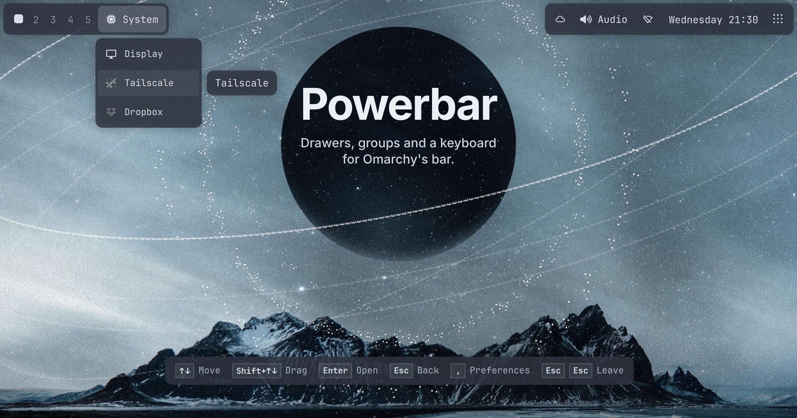
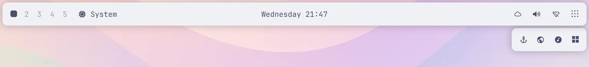
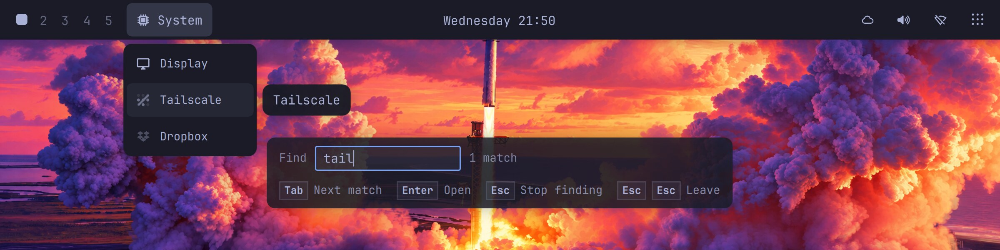
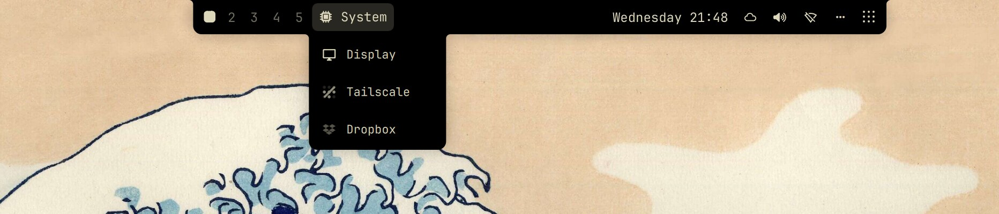

<div align="center">

# Powerbar

[](https://github.com/tcballard/omarchy-badges)
[](https://hypr.land)
[](LICENSE)



</div>

Powerbar is Omarchy's bar, rebuilt by someone who looks at their bar all day.
On a fresh install it looks like the bar you already have, down to the
spacing, with one small button at the far end. From there you can tuck
widgets away in drawers of two kinds: a Bartender-style strip of live icons
that slides out beside the bar, or a menu whose rows show each widget's name,
on its own or next to its icon. Everything below waits until you turn it on
(only its two keyboard shortcuts are offered, in a notification on the first start),
and then behaves the same way every time. Things move with some care, too:
drawers grow out of the bar and neighbours slide aside for a dragged widget,
all of it carefully timed, so the bar never feels slow. If you'd rather it
didn't move at all, one switch turns animation off.

### What you get

- Widgets you rarely read can go On demand. They leave the bar and slide back
  for a couple of seconds when something in them changes, so a pending update
  still catches your eye (each widget has its own *Show on activity* switch).
  Hover their zone and they open in a drawer beside the bar, or, if you
  prefer, unfold in place behind the zone's dots, or open from the dots as
  a menu of icons and names, with On demand groups as submenus.
- Related widgets can share one icon as a group, opening as a strip or a named
  menu, with a badge that adds up their unread counts.
- The bar can stay flat like Omarchy's, float as one surface, or split into
  islands, and it can autohide until you push the pointer to the edge. With
  autohide, a widget that changes comes out alone for a couple of seconds,
  on a small badge in the bar's shape at its own place along the edge, while
  the bar stays hidden.
- Omarchy's clear, glassy and opaque backgrounds all work: a double click on
  the bar steps through them, and highlights deepen on a see-through bar so
  they still show over the wallpaper.
- Large bar adds a 6 px lip above and below every widget, so a 28 px side bar
  becomes 40 px wide. Icons and text keep their size and get room to breathe,
  and the hover highlights grow with the bar. It helps most on a left or right
  edge, where the stock strip is narrow.
- Omarchy's five zones: Left, Left of center, Center, Right of center and
  Right, the same sections Omarchy's own bar reads, so both bars agree on
  where everything goes. Center sits over the middle of the bar; on a
  MacBook's notched screen it starts right of the camera, with Left of
  center ending left of it.
- The Notch style grows two black ears out of a MacBook's camera: with
  autohide they spring out of it when you point at the camera, and an ear
  that outgrows the screen wraps onto a second row at the edge. On other
  screens and edges it draws as islands.
- Rounding, borders, blur and shadow follow each theme until you change them,
  for every theme at once or just the one you're on.
- You never need the mouse. A shortcut puts a cursor on the bar; the arrows
  walk it, Tab jumps zone to zone, the key that points into the screen opens a
  group or a drawer, and Enter opens what's under the cursor. Shift with the
  arrows drags the widget under the cursor along the bar, into the next zone,
  onto the dots or into a drawer. Esc steps back one level, and Esc twice
  gives the keyboard back to your window.
- Apps' tray icons can leave Omarchy's tray and live on the bar like any
  widget: on the bar, on demand, hidden or in a group, with the same click,
  right-click menu and scroll as in the tray. Put one back and the tray
  shows it again.
- `/` is a fuzzy finder. Type a few letters of a name in order and the best
  match comes first: `/pm` finds Plugin Manager, and a group's name finds its
  members. It reaches every widget you haven't hidden, wherever it sits, and
  opens the way there: into a group, out from behind a zone's dots, or into a
  drawer.
- Any widget or group can have its own shortcut, and `?` lists them all. The
  Preferences window works the same way, with the keys for whatever has focus
  shown along its bottom edge.
- Everything in Preferences is also a command (`omarchy-shell powerbar help`),
  so a script or your coding agent can rearrange the bar for you.

### What went into the details

- Every glyph sits in a square cell of
  the same size, so hover highlights match from one icon to the next, menu rows
  are inset so their corners follow the menu's, and on a flat bar the end
  icons land exactly where Omarchy puts them.
- Spacing is measured from what each icon actually paints. Switch to Equal
  gaps and every glyph gets the same air on both sides, whether it is a thin
  mic icon or a wide battery readout. Powerbar reads each glyph's real bounds
  from its font, which is how it caught a speaker icon sitting 3.5 px off
  centre. Equal slots, the default, keeps the even grid of Omarchy's bar.
- Motion is tuned to distance. Neighbours make room for a dragged widget a
  little longer the further they have to move, the widget glides into its
  slot, and drawers close faster than they open. The hover highlight and the
  outline of where a drag will land slide from one place to the next instead
  of blinking. Turn Animations off and all of it happens at once.
- It stays quick. Drop a widget and the bar shows it in place in about 8 ms.
  Saving the change stalls Omarchy's shell for 400 ms or so, so Powerbar
  saves once you've moved off the bar, where you don't see it. Widgets
  in drawers stay loaded, and Powerbar notices their changes as they happen
  instead of checking on a timer.
- Keys are named by where they point, so they mean the same thing on a top,
  bottom or side bar, and a name card beside the cursor tells you what you're
  on.
- It tries hard not to surprise you. It binds no key until you accept one:
  on first start a notification offers its two bar shortcuts and opens
  Preferences at them. Omarchy's `omarchy bar` commands
  keep working, a shortcut Hyprland rejects puts your files back as they
  were, and settings for an uninstalled widget clean themselves up.

Powerbar is based on the [Omarchy bar](https://github.com/omacom/omarchy/tree/quattro/shell/plugins/bar),
whose original copyright and MIT license notice are preserved in
[LICENSE](LICENSE).

## Screenshots

Each is one untouched capture of Powerbar on a stock Omarchy theme and its
own wallpaper. The themes and wallpapers are Omarchy's (MIT).

<p><br>
<sub><b>Floating</b>, catppuccin-latte: On demand widgets in their zone's drawer</sub></p>

<p><br>
<sub><b>Flat</b>, tokyo-night: <code>/tail</code> opens the System group at Tailscale, with the key strip below</sub></p>

<p><br>
<sub><b>Notch</b>, kanagawa, on a 14-inch MacBook screen: the zones grow out of the camera and a group slides down from it</sub></p>

<p><br>
<sub><b>Preferences</b>, osaka-jade: the Layout page, with the keys for what has focus along the bottom</sub></p>

## Install

```sh
omarchy plugin add https://github.com/overp0werj0int/powerbar.git
omarchy bar use p0werj0int.powerbar
```

Until you change something, Powerbar draws Omarchy's bar plus one button:
flat, on the edge `bar.position` names, at your theme's size, every widget in
Omarchy's sections, order and spacing, nothing on demand. A notification
offers two shortcuts, Super+B for the keyboard mode and Super+Ctrl+/ for its
search; none is bound until you take it (below).
The nine-dot button at the far right (bottom of a side bar) opens
Preferences.

Back to Omarchy's bar at any time: `omarchy bar reset`. Your Powerbar
settings stay in `~/.config/omarchy/shell.json` for when you come back.

Needs Omarchy 4 (Quattro) and nothing else: Powerbar is QML and shell
scripts, with no compiled helpers, packages or build step. Tested on aarch64
(Asahi) with Omarchy 4.0.4 and the next version's development build
(omarchy-dev r7017, Hyprland 0.56.2, Quickshell 0.3.2, Qt 6.12); x86_64 is
not tested separately.

### Shortcuts for the keyboard mode

Powerbar binds no keys by itself. On its first start a notification offers
Super+B for the keyboard mode and Super+Ctrl+/ for the mode with its search
(/) open, and names whatever already holds either one. It stays until you
dismiss it; click it and Preferences opens at Behavior → Keyboard, where Enter
takes the suggested keys and Space lets you choose others. To bind them from
the command line instead:

```sh
omarchy-shell powerbar set shortcut.bar:keys "SUPER + B"
omarchy-shell powerbar set shortcut.bar:search "SUPER + CTRL + SLASH"
```

A key that is taken is refused with what holds it; add `'{"keys":"…","replace":true}'`
in place of the keys to take it anyway. Powerbar writes them to a marked
block in `~/.config/hypr/bindings.lua`; `omarchy-shell powerbar
clearShortcuts` removes it.

## Update

```sh
omarchy plugin update p0werj0int.powerbar
```

It shows the code changes and asks before applying them (`--yes` skips the
question); the shell then reloads its plugins and the bar redraws once.
`omarchy-shell powerbar build` tells you which version the shell is running.

## Remove

```sh
omarchy-shell powerbar clearShortcuts
omarchy plugin remove p0werj0int.powerbar
```

The first line takes Powerbar's shortcuts out of Hyprland; it needs Powerbar
running as your bar, so do it before removing (and before `omarchy bar
reset`). Removing deletes the plugin's folder and, if Powerbar was your bar,
puts Omarchy's bar back.

What stays behind is harmless to Omarchy's bar and is picked up again if you
reinstall. Omarchy's bar shows every widget, so ones you hid or put On
demand in Powerbar are back on it, in the same five zones. To remove the
rest too:

| What | Where | To clean |
| --- | --- | --- |
| Settings | `bar.powerbar*` keys, and `powerbar*` keys in each widget entry of `bar.layout`, in `~/.config/omarchy/shell.json` | The `jq` command below |
| Shortcuts | The block from `-- >>> powerbar: …` to `-- <<< powerbar` in `~/.config/hypr/bindings.lua` | `omarchy-shell powerbar clearShortcuts` before removing (or clear each one in Preferences); afterwards, delete the block, markers included, and `hyprctl reload` |
| Blur rules you added | The `powerbar` layer rules from [Backdrop blur](#backdrop-blur) in your Hyprland config | Delete them |
| Theme files you wrote | `powerbar.toml` in `~/.config/omarchy/themes/<name>/` (Powerbar only reads them) | Delete them |
| Icons you added to groups | `$XDG_DATA_HOME/powerbar/icons` (`~/.local/share/powerbar/icons`) | `rm -r ~/.local/share/powerbar` |
| Images of your widgets | `$XDG_CACHE_HOME/powerbar` (`~/.cache/powerbar`) | `rm -r ~/.cache/powerbar` |

```sh
f=~/.config/omarchy/shell.json; cp "$f" "$f.bak"
jq 'def clean: with_entries(select(.key | startswith("powerbar") | not));
  .bar |= (clean | if .layout then .layout |= map_values(if type == "array"
    then map(if type == "object" then clean else . end) else . end) else . end)' \
  "$f.bak" > "$f.new" && mv "$f.new" "$f"
```

## Preferences

Four pages, all usable from the keyboard (a legend at the bottom left
lists the keys for whatever has focus):

- **Layout**: your bar as shelves (On the bar, On demand, Hidden), the first
  two with the five zones (Hidden is one slab of widgets in bar order), the
  camera between Left of center and Center on a notched screen. On a side
  bar the shelves turn to run down the screen. Drag or pick
  up widgets to move them; the tile below holds the selected widget's zone
  (a small map of the bar), visibility, *Show on activity*, group and
  shortcut. A fourth
  shelf, In the tray, lists the icons in Omarchy's tray: drag one onto a
  shelf above to move it out of the tray, or back to return it.
- **Groups**: the Layout page's camera over three of its tilted plates. The
  first holds every group's face where the bar puts it, a row each in its
  zone's tile (on demand ones with a ring, hidden ones dashed; four in view,
  more scroll) with a "+" under them; the second is each zone's drawer,
  showing the group whose face you choose (the faces are its tabs); the third
  is the widgets in no group, in bar order. Pick up a widget and drop it in a
  drawer, on a face, the slab or a zone's "+" (a new group there);
  the inspector at the bottom right holds the chosen group's name, how it
  shows, its layer, zone, icon (your widgets' glyphs, Omarchy's icons and
  emoji, or your own SVG or PNG) and shortcut.
- **Look**: one tilted plate under the camera with a strip each for Style
  (Flat, Floating, Islands, and Notch on a MacBook, and the screen edge),
  Size (large bar, spacing), Shape, Surface, Shadow and, on a notched
  screen, Notch (the camera's width and height). Numbers are faders that
  lie along a strip's bottom. In the Notch style, what can't apply there
  gives way to what does.
- **Behavior**: the same plate with Comes and goes (autohide, show on widget
  activity, readable over windows, animations), On demand (drawer, bar or
  menu, and the count on the dots) and Keyboard (the mode's shortcuts and
  its key legend). Changes on both pages show on the bar as you make them.

| Where | Keys |
| --- | --- |
| Anywhere | `1`–`4` switch pages (Ctrl+`1`–`4` while typing), Ctrl+Tab cycles them, Esc or `,` closes (`,` back to the keyboard mode when it came from there) |
| Look and Behavior | `j` / `k` down and up a strip and on to the next, `h` / `l` a fader's value, chip to chip on a row of chips, else the same row in the next strip; Tab / Shift+Tab the next or previous strip, Space toggles or chooses, Enter records a shortcut |
| Faders | `h` / `l` step (Shift or Page Up / Down for five), Home / End for the ends, Backspace for the theme's value or the default, Enter applies at once, Esc undoes a value not yet applied |
| Layout shelves | `h` `j` `k` `l` move; Space picks up a widget, then `h` / `l` move it and `j` / `k` change its shelf; Space or Enter drops it, Esc puts it back; Enter on a widget goes to its settings; `x` hides or restores; `g` on a group opens it on the Groups page |
| Groups faces | `h` / `l` the same row in the next zone, `j` / `k` down the zone's faces and its "+", then on to its drawer; Space picks up a face, `h` / `l` move it, Space drops it; Shift+`h` / `l` move it to the next zone at once, Shift+`j` / `k` on the bar, on demand, hidden; `n` makes a group, `x` twice dissolves it, Enter goes to its name |
| Groups drawers and slab | `j` / `k` walk (a drawer's header too; from the header `k` back to the "+"), `h` / `l` the same row in the next drawer; Space picks up a widget, then `h` `j` `k` `l` move it through the drawers, the slab, the faces and the "+" rows, Space drops it, Esc puts it back; Shift with `h` `j` `k` `l` moves it at once; `x` takes it out; on the slab Enter adds it to the chosen group and typing filters |
| Icon picker | Type to search, arrows move, Enter chooses, Tab changes the source, Ctrl+V pastes an image or a glyph |

## Keyboard mode

Super+B starts it, once you take that shortcut in Preferences → Behavior →
Keyboard (the first start's notification leads there). The cursor starts on the widget
whose panel is open, else on the first widget in Center (the clock on
Omarchy's stock bar). A name card beside the cursor says what it's on, and a
strip along the far edge of the screen shows the keys you can press now
(Preferences → Behavior → Keyboard → Key legend turns it off). Keys are named by
direction relative to the bar, so they mean the same on every edge:

- The arrows (or h j k l) along the bar move the cursor; Home / End (or `^` /
  `$`) jump to the ends, in a drawer too; Tab / Shift+Tab (or Page Down / Page
  Up) jump zone to zone.
- A zone's drawer unfolds as the cursor reaches the zone, as it does for the
  pointer. The key that points into the screen (↓ on a top bar) goes into it
  or into a group, and the opposite key comes back. A strip of icons is walked
  along the bar, like the bar itself; a menu of names, row by row. On the
  notch, a zone's second row is walked as a grid.
- Enter or Space opens the widget, a group, a zone's dots or Preferences (the
  last stop).
- Shift with the arrows (or Shift+h j k l) drags the widget or group icon
  under the cursor one place at a time, and the cursor goes with it. Past a
  zone's end it moves into the next zone; onto the dots it goes On demand and
  the zone opens with it; in a drawer or a group's menu it reorders the
  members. Shift with the into and out keys moves a widget into an open zone
  drawer and back onto the bar. The change is saved once you leave the bar.
- `/` finds a widget by name, fuzzily (`/pm` finds Plugin Manager), and opens
  the way to it, into a group, a drawer or behind dots. Super+Ctrl+/ starts
  the mode with the search already open (`omarchy-shell powerbar
  keysSearch`; offered in Preferences → Behavior → Keyboard as "Bar search"); pressed during a search, it leaves.
- `?` shows a sheet of every key in the mode and every widget's and group's
  shortcut.
- `,` opens Preferences; `,` there closes them and brings the cursor back
  where it was.
- Esc closes the innermost thing; Esc twice quickly ends everything and gives
  the keys back to your window. So does Super+B again, a click outside the
  bar, or a new window opening.

## Shortcuts

A widget's or group's settings show the shortcut that opens it, whether it
comes from Omarchy, your Hyprland files or Powerbar. Press Enter on it to
record new keys; keys already in use are named and you choose whether to take
them. `x` removes a shortcut and Backspace restores Omarchy's. Powerbar writes its shortcuts the way Omarchy plugins do, as a marked
block in `~/.config/hypr/bindings.lua` (everything outside the markers is left
alone), so Super+K lists them.

## Command line

Omarchy's own commands work on Powerbar as on its bar: `omarchy bar position`,
`background` (or `transparent`), `put`, `move`, `set`, `use`, `reset`, `defaults`, `omarchy
toggle bar`, and the panel shortcuts (`omarchy-shell shell toggle <id>`).
Everything Powerbar adds answers to `omarchy-shell powerbar <function>`;
`omarchy-shell powerbar help` lists them. Answers are JSON, `ok`, or
`error: …` with the reason, and changes go through the same checks as
Preferences.

| Command | Does |
| --- | --- |
| `status` | Every setting, widget, group and shortcut, and what the bar is doing |
| `settings` | Every setting: type, values, `shell.json` key |
| `get <setting>` / `set <setting> <value>` / `reset <setting>` / `toggle <setting>` | Read, change, restore the default, flip a switch |
| `widgets` / `setWidget <widget> <json>` | The layout; move or change one (`zone`, `visibility`, `before`, `group`, `activityPeek`, `badgeProperty`, `urgentProperty`) |
| `groups` / `newGroup <name>` / `setGroup <group> <json>` / `removeGroup <group>` | Groups and their members |
| `shortcuts` / `clearShortcuts` | Every shortcut on the bar and where its keys come from; remove all of Powerbar's |
| `show` / `hide` | Hold an autohidden bar out until `hide`; or switch the bar on and off |
| `keys` / `keysOn` / `keysOff` / `keysStatus` | The keyboard mode |
| `keysSearch` | The keyboard mode with its search (`/`) open; ends it while a search is open |
| `managed <zone>` / `group <id>` / `toggleGroup <id>` / `closeManaged` | Open or close a drawer |
| `drawerStatus` / `managedStatus` / `popupStatus` | The open drawer, On demand widgets, the open panel |
| `preferences` / `preferencesPage <n>` / `preferencesKeyboard` / `groupsPreferences` / `closePreferences` | Preferences (`preferencesKeyboard`: at the keyboard mode's shortcuts) |
| `build` | The code this shell is running: version, a digest of the files it loaded, git commit, when it loaded |
| `help` | Every function, with what it does |

Settings are named as in Preferences (`style`, `autoHide`, `onDemand`,
`spacing`, `shape.rounding`, `surface.opacity`, `shadow.scope`…), plus a few
with no control in Preferences: `revealSeconds` (how long activity shows a
widget, 2.5 s), `entryGraceSeconds` and `exitGraceSeconds` (how long a drawer
waits for the pointer, 1 s each). Shortcuts are `shortcut.bar:keys`,
`shortcut.bar:search`, `shortcut.group:<id>` and `shortcut.widget:<plugin id>`.

```sh
omarchy-shell powerbar set onDemand inline
omarchy-shell powerbar toggle autoHide
omarchy-shell powerbar setWidget omarchy.bluetooth '{"visibility":"managed"}'
omarchy-shell powerbar setGroup "$(omarchy-shell powerbar newGroup Sound | jq -r .id)" \
  '{"members":["omarchy.audio","omarchy.microphone"],"face":"both"}'
omarchy-shell powerbar set shortcut.bar:keys "SUPER + B"
omarchy-shell powerbar set shortcut.bar:search "SUPER + CTRL + SLASH"
```

## For theme authors: `powerbar.toml`

A theme can ship `powerbar.toml`, and you can add or change one for any theme
in Omarchy's overlay folder (`~/.config/omarchy/themes/<name>/powerbar.toml`).
Every key is optional; what it leaves out comes from Omarchy and Hyprland. It
applies in full while a tile is set to *Theme*, and under *Everywhere* or
*Just here* for any value you haven't set. An edit in the overlay folder
takes effect the next time the theme is applied (`omarchy theme set
<name>`).

```toml
[shape]
rounding = 12        # stored units, as the slider
borders = true
border-width = 1

[surface]
opacity = 85         # percent, 0–100
blur = true
over-windows = 65    # percent: drawers and menus at least this opaque
text = "light"       # theme | light | dark

[shadow]
enabled = true
softness = 10        # 2–24
strength = 30        # percent, 5–60
```

## Backdrop blur

Blur behind the bar (Surface > Background blur, or Omarchy's glassy bar
background) needs these layer rules in your Hyprland Lua
configuration (for example `~/.config/hypr/looknfeel.lua`). `blur_popups`
blurs the bar's tooltips too. Drawers, peeks and menus are drawn in the bar's
own layer and need nothing more. The notch is always opaque and never
blurs.

```lua
hl.layer_rule({
  match = { namespace = "^powerbar$" },
  no_anim = true,
  animation = "none",
  blur = true,
  blur_popups = true,
  ignore_alpha = 0.01,
})
hl.layer_rule({
  match = { namespace = "^powerbar-clear$" },
  no_anim = true,
  animation = "none",
  blur = false,
})
```

## For widget authors

Widgets need nothing special to work in Powerbar. To show activity on demand,
Powerbar watches `text`, `icon`, `iconText`, `value`, `displayValue`,
`powerbarIcon`, `powerbarValue` and `powerbarActivityRevision` on your widget
and its bar buttons, or a `signal powerbarActivity()` for repeated events.
Only text, number and true/false values count. Group badges read the first
positive number among `unseenCount`, `downCount`, `updateCount`,
`badgeCount`, `notificationCount`, `unreadCount`, `alertCount`,
`pendingCount` and `count`, and turn urgent on `hasUnseenPerson`, `urgent`,
`isUrgent`, `critical`, `hasAlert` or `severe`. A user can point a widget at
other properties (`badgeProperty`, `urgentProperty`). Powerbar adds no
polling.

## Known limitations

- **Widgets that talk to their own background service do nothing on any
  replacement bar, Powerbar included.** Some widget plugins come in two parts,
  a bar widget and a service that does the work (kinds `bar-widget` and
  `service`; for example OmaSettings, Everything, Omapop, Notification Center,
  Omatop, Reprieve, Plume). The widget reaches its service with
  `bar.shell.serviceFor()`. Since Omarchy 4.0.3 that only works under
  Omarchy's own bar: widgets hosted by any third-party bar get a
  "service-less" facade on purpose, so a bar from outside can't get at other
  plugins' services ([#9618](https://github.com/omacom/omarchy/pull/9618);
  Omarchy's [shell reference](https://github.com/omacom/omarchy/blob/quattro/docs/omarchy-shell.md),
  "A third-party replacement bar…"). Under Powerbar such a widget shows, but its button does nothing, its
  panel waits forever ("warming up", "Reading the archive…") or it draws empty;
  the service itself keeps running, and its own shortcuts and commands still
  work. Powerbar can't fix this from its side; it needs a change in Omarchy.
  Reported as [#11051](https://github.com/omacom/omarchy/issues/11051),
  [#11713](https://github.com/omacom/omarchy/issues/11713),
  [#11796](https://github.com/omacom/omarchy/issues/11796),
  [#12648](https://github.com/omacom/omarchy/issues/12648),
  [#13289](https://github.com/omacom/omarchy/issues/13289) and
  [#13794](https://github.com/omacom/omarchy/issues/13794)
  ([#11949](https://github.com/omacom/omarchy/issues/11949) was closed, and
  [#14101](https://github.com/omacom/omarchy/issues/14101) as a duplicate of
  #11051); fixes proposed in
  [#13633](https://github.com/omacom/omarchy/pull/13633) (each widget reaches
  only its own plugin's service),
  [#13194](https://github.com/omacom/omarchy/pull/13194),
  [#13471](https://github.com/omacom/omarchy/pull/13471),
  [#11970](https://github.com/omacom/omarchy/pull/11970) and
  [#12260](https://github.com/omacom/omarchy/pull/12260), none merged as of
  October 23, 2026. [#13842](https://github.com/omacom/omarchy/pull/13842)
  would log a warning when such a lookup is refused, so the failure shows in
  the shell log. Until then, use such a widget's own shortcut or command, or
  `omarchy bar reset` to go back to Omarchy's bar.
- **Scrolling layout: a click on the bar can scroll the view.** This is
  Hyprland's: its scrolling layout scrolls the focused window into view on
  every mouse button release over any part of it, even when the click landed
  on a bar drawn over it ([hyprwm/Hyprland#13558](https://github.com/hyprwm/Hyprland/discussions/13558);
  a partial fix in Hyprland 0.56 does not cover clicks on a bar).
  Powerbar meets it wherever a window sits under the bar: with autohide on,
  and on a side bar. Until Hyprland fixes it, `scrolling:follow_focus = false`
  stops it, at the cost of clicks and hovers no longer bringing a partly
  hidden window into view.
- **The notch's shape comes from Apple's artwork.** Omarchy describes how
  tall a notch is, not how wide, so Powerbar keeps each MacBook panel's
  notch and screen corners in `notch-panels.json`, measured on Apple's
  product bezel images, which draw each screen pixel for pixel. If the zones
  overlap the camera or leave a gap beside it, set Preferences > Bar >
  Notch > Notch width (`omarchy-shell powerbar set notchWidth N`); Notch
  height (`notchHeight N`) does the same for the height. Reset, in the
  tile's header, goes back to the measured size. Center's widgets sit on the
  right of the camera; drag the dot beside the camera on the Layout page
  (or `set centerSide left`) to put them on the left.
- **One layout for every screen.** In the Notch style, a screen without a
  notch shows the zones as black islands.
- Multi-monitor setups are less tested than single-monitor ones.

## What Powerbar touches

Powerbar runs inside the Omarchy shell, as you: no daemon or service of its
own, nothing that needs root, and no network connections. Beyond the
commands below, it follows Hyprland's focused monitor and asks it for
keyboard focus in the keyboard mode, through Quickshell's Hyprland module.

| File | Read | Written |
| --- | --- | --- |
| `~/.config/omarchy/shell.json` | Its settings and Omarchy's bar keys | Through the shell, only under `bar`: its own `powerbar*` keys, the bar keys you change in Powerbar (`layout`, including the tray's `hidden` and `pinned` lists when you move an icon out of it or back, `position`, `background` / `transparent`; `centerAnchor` only on an Omarchy without the center's sections), and on first start a `powerbarInstance` id on each widget entry. Edits made at the bar are saved together once you leave it (at most 20 s after the last one), and nothing is written while the config names another bar. Omarchy's bar commands write it as they always do |
| `~/.config/hypr/bindings.lua` | With your other `~/.config/hypr/*.lua` files, Omarchy's default bindings and `hyprctl binds`, to show every shortcut | Only its marked block, when you set a shortcut: replaced in one step (through a symlink, in the file it points to), and put back if Hyprland then reports a new config error. Once Hyprland has taken the block, it also removes the marked loader in `hyprland.lua` (backed up first) and the `~/.config/hypr/powerbar.lua` it loads, left by early Powerbar builds (only when it still has their generated header); a damaged loader is left alone |
| `~/.local/state/omarchy/` | `current/theme/powerbar.toml`, `current/theme.name`, `toggles/bar-off` | `toggles/bar-off`, only through Omarchy's own toggle commands: `powerbar show` / `hide`, and Omarchy's bar toggle on an autohidden bar |
| `~/.config/omarchy/themes/`, `$OMARCHY_PATH` | Installed themes (to drop settings for themes you removed), Omarchy's emoji list, whether Omarchy has the glassy background | Nothing |
| `/usr/share/omarchy-platform/display-cutouts.json` | Which screens have a notch, and how tall, as Omarchy's bar reads it | Nothing |
| The folder of a widget's plugin (`~/.config/omarchy/plugins/<id>`, `$OMARCHY_PATH/shell/plugins/…`) | Only when the shell's widget list has lost that widget's component: its `manifest.json` and the bar widget QML it names, as the shell loads them | Nothing |
| `$XDG_DATA_HOME/powerbar/icons` | The image you pick or paste | Icons you add to groups (SVG or PNG, 512 KB at most); unused ones are deleted. Private: the folders are made 0700 and the icons 0600 |
| `$XDG_CACHE_HOME/powerbar` | | Images of your widgets for Preferences (they show what the widget showed, such as a window title), `faces.json`, `glyphs.json`, `tuning.json` with `powerbarTuning` on, and once, `zone-layouts-<date>.json`: the arrangements earlier versions kept per zone mode, copied out of `shell.json`. Private: the folders are made 0700, so no other user can open them |

| Command | When |
| --- | --- |
| `omarchy-toggle-bar`, `omarchy-toggle bar-off off` | `omarchy-shell powerbar show` / `hide`; Omarchy's bar toggle on an autohidden bar |
| `omarchy-bar-text-color` | A transparent bar picks its text colour over the wallpaper, as Omarchy's does |
| `omarchy-bar background`, `omarchy-bar sync-glass` | The bar's background changes, on an Omarchy with the glassy background |
| `notify-send` | First start: offers the bar shortcuts (free, or what holds them) in a notification that stays until dismissed; a click opens Preferences at them |
| `hyprctl binds`, `cat` | Reading shortcuts (Preferences, the keyboard mode, `shortcuts`) |
| `hyprctl reload config-only`, `hyprctl configerrors` | After writing the shortcut block (`ShortcutApply.sh`, with `grep`, `awk`, `cp`, `mv`, `readlink`) |
| `hyprctl eval` | Recording a shortcut: a temporary submap so the keys reach Preferences, for 15 s at most |
| `hyprctl binds -j` with `jq`, `hyprctl repl` | Omarchy's bar toggle on an autohidden bar: finds the toggle's key and checks every 50 ms whether it is still held, for 60 s at most |
| `wl-paste` | Ctrl+V in the icon picker (the image read under `timeout 2s`) |
| `ls`, `mkdir`, `cp`, `stat`, `rm` | The icon and image folders above, and the list of installed themes |
| `[[ -f … ]]` (in `bash -c`) | Whether `toggles/bar-off` is set, at load and when it changes |
| `BuildStamp.sh` (`find`, `sha256sum`, `git rev-parse`, `git status`) | Once as the bar loads, on Powerbar's own folder only, for `omarchy-shell powerbar build` |
| Your custom modules' `exec`, `onClick`…, and commands widgets ask the bar to run | Through `bash -lc`, as on Omarchy's bar |

## Troubleshooting

**A widget's button does nothing, or its panel never finishes loading.** If
the widget comes with a background service, this is Omarchy's limit on
replacement bars, not a fault in the widget: see Known limitations.

**The bar is gone.** If it was switched off with Omarchy's bar toggle
(Super+Shift+Space, `omarchy toggle bar`), `omarchy-shell powerbar show`
brings it back, as does `omarchy toggle bar off` (the word names Omarchy's
`bar-off` flag, so `off` shows the bar). While it is off, widgets still peek
out on their own when they change (Show on widget activity). With autohide
on, the toggle never hides the bar: it slides out while you hold the keys. An autohidden bar comes
out when the pointer reaches its edge; `omarchy-shell powerbar show` holds it
out until `hide`, and `omarchy-shell powerbar set autoHide off` ends
autohide. If `omarchy-shell powerbar status` does not answer, run `omarchy
restart shell`. Still nothing: `omarchy bar reset` returns to Omarchy's bar
(it works without the shell, from a TTY too), keeping your Powerbar
settings; `omarchy bar use p0werj0int.powerbar` comes back.

**Widgets show placeholders.** The shell can hand Powerbar a copy of its
widget list in which some widgets have lost their component (switching bars
does this). Powerbar loads those widgets from their own plugins at once.
`omarchy-shell powerbar status` lists them under `runtime.registry.repaired`;
one it could not load is under `runtime.registry.failed`, with the reason,
and named in the shell log.
If placeholders remain, `omarchy restart shell`.

**A shortcut does nothing.** `omarchy-shell powerbar shortcuts` lists each
one with its `source` (`yours` for one set in Powerbar, `omarchy` or `config`
for Omarchy's and your Hyprland files') and, for yours, `live`: whether
Hyprland has those keys bound right now (`ready: false` means Powerbar
hasn't read Hyprland's binds yet). `live: false` means Hyprland did not
take the block: look in `~/.config/hypr/bindings.lua` for a damaged Powerbar
block (a marker without its pair; Preferences names it) and `hyprctl
configerrors`. A key another bind holds is only taken when you choose to.

**A change isn't in shell.json yet.** The bar shows an edit at once and saves
it once the pointer, the keyboard mode and any widget panel have left the
bar, or 20 s after your last edit if you stay; Preferences saves within
a moment.
Nothing is saved while `shell.json` names another bar: the shell log then
says how many changes were not saved.

## More

How every part behaves, precisely: [docs/behavior/](docs/behavior/README.md).
Working on Powerbar itself: [DEVELOPMENT.md](DEVELOPMENT.md).
Bugs and questions: [issues](https://github.com/overp0werj0int/powerbar/issues).
Security problems: report them privately, as [SECURITY.md](SECURITY.md) describes.
