<div align="center">

# Powerbar

[](https://github.com/tcballard/omarchy-badges)
[](https://github.com/tcballard/omarchy-badges)
[](https://hypr.land)
[](LICENSE)

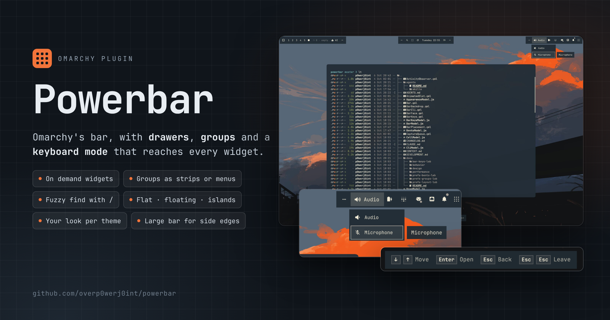

</div>

Powerbar is Omarchy's bar, rebuilt by someone who looks at their bar all day.
On a fresh install it looks like the bar you already have, down to the
spacing, with one small button at the far end. From there you can tuck
widgets away in drawers of two kinds: a Bartender-style strip of live icons
that slides out beside the bar, or a menu whose rows show each widget's name,
on its own or next to its icon. Everything below waits until you turn it on,
and then behaves the same way every time. Things move with some care, too:
drawers grow out of the bar and neighbours slide aside for a dragged widget,
all of it carefully timed, so the bar never feels slow. If you'd rather it didn't move at all, one switch turns animation
off.

### What you get

- Widgets you rarely read can go On demand. They leave the bar and slide back
  for a couple of seconds when something in them changes, so a pending update
  still catches your eye. Hover their zone and they open in a drawer.
- Related widgets can share one icon as a group, opening as a strip or a named
  menu, with a badge that adds up their unread counts.
- The bar can stay flat like Omarchy's, float as one surface, or split into
  islands, and it can autohide until you push the pointer to the edge. On an
  islands bar, activity slides out only the island that changed, with the
  widget highlighted for a couple of seconds, while the others stay tucked
  away.
- Large bar adds a 6 px lip above and below every widget, so a 28 px side bar
  becomes 40 px wide. Icons and text keep their size and get room to breathe,
  and the hover highlights grow with the bar. It helps most on a left or right
  edge, where the stock strip is narrow.
- Rounding, borders, blur and shadow follow each theme until you change them,
  for every theme at once or just the one you're on.
- You never need the mouse. A shortcut puts a cursor on the bar; the arrows
  walk it, Tab jumps zone to zone, the key that points into the screen opens a
  group or a drawer, and Enter opens what's under the cursor. Esc steps back
  one level, and Esc twice gives the keyboard back to your window.
- `/` is a fuzzy finder. Type a few letters of a name in order and the best
  match comes first: `/pm` finds Plugin Manager, and a group's name finds its
  members. It reaches every widget you haven't hidden, wherever it sits, and
  opens the way there: into a group, out from behind a zone's dots, or into a
  drawer.
- Any widget or group can have its own shortcut, and `?` lists them all. The
  Preferences window works the same way, with the keys for whatever has focus
  shown along its bottom edge.
- Everything in Preferences is also a command (`omarchy-shell powerbar help`),
  so a script or your coding agent can rearrange the bar for you.

### What went into the details

- Every glyph sits in a square cell of
  the same size, so hover circles match from one icon to the next, menu rows
  are inset so their corners follow the menu's, and on a flat bar the end
  icons land exactly where Omarchy puts them.
- Spacing is measured from what each icon actually paints. Switch to Equal
  gaps and every glyph gets the same air on both sides, whether it is a thin
  mic icon or a wide battery readout. Powerbar reads each glyph's real bounds
  from its font, which is how it caught a speaker icon sitting 3.5 px off
  centre. Equal slots, the default, keeps the even grid of Omarchy's bar.
- Motion is tuned to distance. Neighbours make room for a dragged widget a
  little longer the further they have to move, the widget glides into its
  slot, and drawers close faster than they open. Turn Animations off and all
  of it happens at once.
- It stays quick. Drop a widget and the bar shows it in place in about 8 ms,
  without waiting the 400 or so it takes Omarchy to save the change. Widgets
  in drawers stay loaded, and Powerbar notices their changes as they happen
  instead of checking on a timer.
- Keys are named by where they point, so they mean the same thing on a top,
  bottom or side bar, and a name card beside the cursor tells you what you're
  on.
- It tries hard not to surprise you. Nothing is bound until you accept a
  shortcut, Omarchy's `omarchy bar` commands keep working, a shortcut Hyprland
  rejects puts your files back as they were, and settings for an uninstalled
  widget clean themselves up.

Powerbar is based on the [Omarchy bar](https://github.com/omacom/omarchy/tree/quattro/shell/plugins/bar),
whose original copyright and MIT license notice are preserved in
[LICENSE](LICENSE).

## Screenshots

<table>
<tr>
<td width="50%"><a href="screenshots/look-nord.jpg">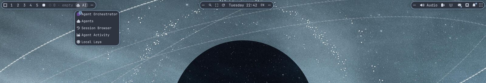</a><br><sub><b>nord</b>: islands, pill corners, soft shadow</sub></td>
<td width="50%"><a href="screenshots/look-hinterlands.jpg">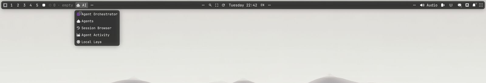</a><br><sub><b>hinterlands</b>: floating, blur, deeper shadow</sub></td>
</tr>
<tr>
<td width="50%"><a href="screenshots/look-waffle-cat.jpg">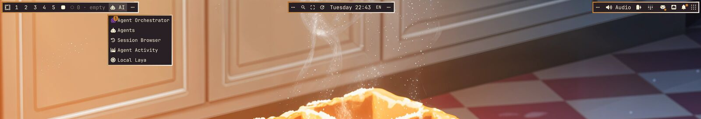</a><br><sub><b>waffle-cat</b>: square islands, 2 px borders</sub></td>
<td width="50%"><a href="screenshots/look-venice-from-above.jpg">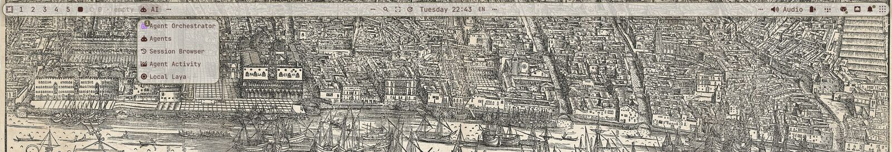</a><br><sub><b>venice-from-above</b>: floating, blur at 70%</sub></td>
</tr>
<tr>
<td width="50%"><a href="screenshots/look-quattrocento-light.jpg">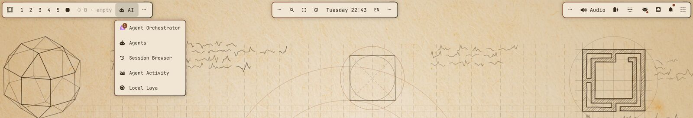</a><br><sub><b>quattrocento-light</b>: large bar on a light theme</sub></td>
<td width="50%"><a href="screenshots/look-everforest.jpg">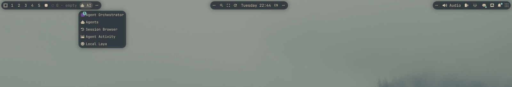</a><br><sub><b>everforest</b>: islands without borders, blur</sub></td>
</tr>
</table>

<table>
<tr>
<td width="33%"><a href="screenshots/keys-search.jpg">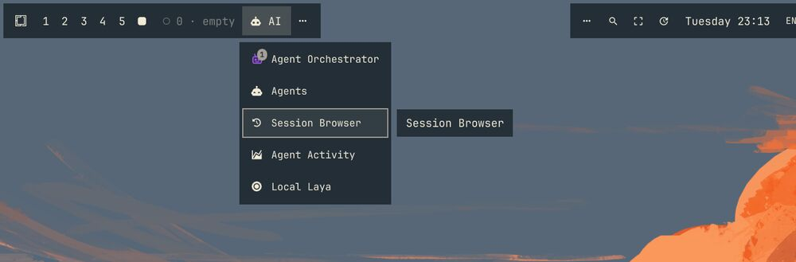</a><br><sub><code>/sess</code> opens the group and lands on the row</sub></td>
<td width="33%"><a href="screenshots/keys-walk.jpg">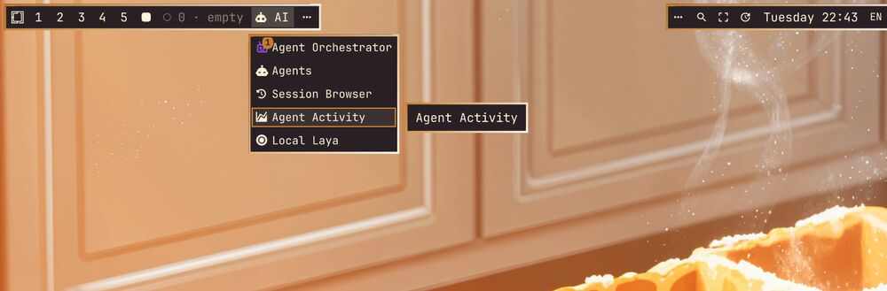</a><br><sub>Arrows walk the menu; the name card follows</sub></td>
<td width="33%"><a href="screenshots/keys-sheet.jpg">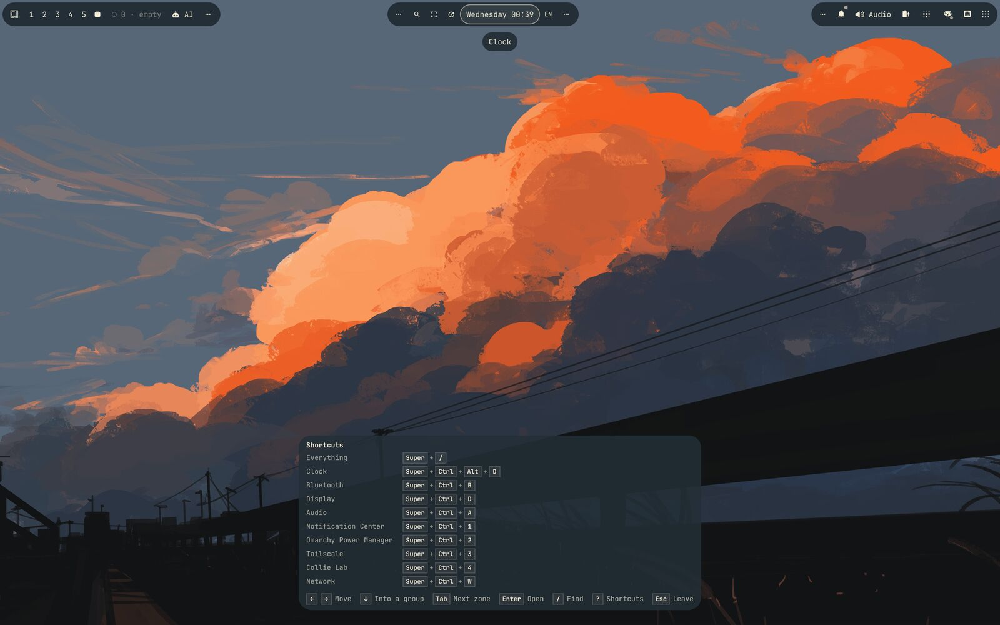</a><br><sub><code>?</code> lists every shortcut as keycaps</sub></td>
</tr>
</table>

<details>
<summary>More screenshots</summary>

<p>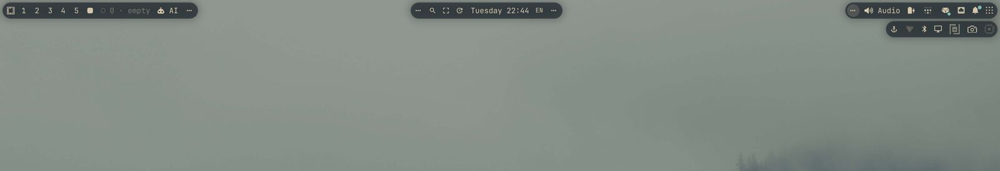<br><sub>On demand widgets in their zone's drawer</sub></p>
<p>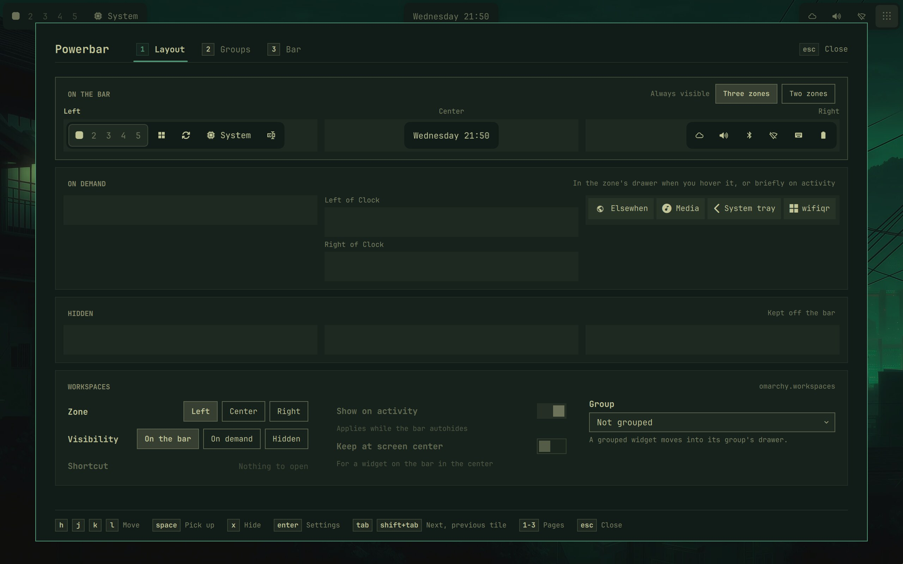<br><sub>Preferences: the Bar page</sub></p>

</details>

## Install

```sh
omarchy plugin add https://github.com/overp0werj0int/powerbar.git
omarchy bar use p0werj0int.powerbar
```

Until you change something, Powerbar draws Omarchy's bar plus one button:
flat, on the edge `bar.position` names, at your theme's size, every widget in
Omarchy's sections, order and spacing, nothing on demand, no shortcuts bound.
The nine-dot button at the far right (bottom of a side bar) opens
Preferences.

Back to Omarchy's bar at any time: `omarchy bar reset`. Your Powerbar
settings stay in `~/.config/omarchy/shell.json` for when you come back.

Needs Omarchy 4 (Quattro). Tested on Omarchy 4.0.4-1, Hyprland 0.56.2 and
Quickshell 0.3.1.

### Optional: Super+B for the keyboard mode

Nothing is bound on install. To start the keyboard mode with Super+B (once
the bar is up):

```sh
omarchy-shell powerbar set shortcut.bar:keys "SUPER + B"
```

Powerbar writes it to a marked block in `~/.config/hypr/bindings.lua`;
`omarchy-shell powerbar clearShortcuts` removes it.

## Update

```sh
omarchy plugin update p0werj0int.powerbar
```

It shows what changed and asks before applying it (`--yes` skips the
question); the shell then reloads its plugins and the bar redraws once.

## Remove

```sh
omarchy-shell powerbar clearShortcuts
omarchy plugin remove p0werj0int.powerbar
```

The first line takes Powerbar's shortcuts out of Hyprland; it needs Powerbar
running, so do it before removing. Removing deletes the plugin's folder and,
if Powerbar was your bar, puts Omarchy's bar back.

What stays behind is harmless to Omarchy's bar and is picked up again if you
reinstall. To remove it too:

| What | Where | To clean |
| --- | --- | --- |
| Settings | `bar.powerbar*` keys, and `powerbar*` keys in each widget entry of `bar.layout`, in `~/.config/omarchy/shell.json` | The `jq` command below |
| Shortcuts | The block from `-- >>> powerbar: …` to `-- <<< powerbar` in `~/.config/hypr/bindings.lua` | `omarchy-shell powerbar clearShortcuts` before removing (or clear each one in Preferences); afterwards, delete the block, markers included, and `hyprctl reload` |
| Theme files you wrote | `powerbar.toml` in `~/.config/omarchy/themes/<name>/` (Powerbar only reads them) | Delete them |
| Icons you added to groups | `$XDG_DATA_HOME/powerbar/icons` (`~/.local/share/powerbar/icons`) | `rm -r ~/.local/share/powerbar` |
| Images of your widgets | `$XDG_CACHE_HOME/powerbar` (`~/.cache/powerbar`) | `rm -r ~/.cache/powerbar` |

```sh
f=~/.config/omarchy/shell.json; cp "$f" "$f.bak"
jq 'def clean: with_entries(select(.key | startswith("powerbar") | not));
  .bar |= (clean | if .layout then .layout |= map_values(if type == "array"
    then map(if type == "object" then clean else . end) else . end) else . end)' \
  "$f.bak" > "$f.new" && mv "$f.new" "$f"
```

## Preferences

Three pages, all usable from the keyboard (the footer lists the keys for
whatever has focus):

- **Layout**: your bar as shelves (On the bar, On demand, Hidden), each with
  your three zones. Drag or pick up widgets to move them; the tile below holds
  the selected widget's zone, visibility, *Show on activity*, centring, group
  and shortcut.
- **Groups**: make, name and arrange groups; pick an icon from your widgets'
  glyphs, Omarchy's icons and emoji, or drop in your own SVG or PNG.
- **Bar**: style and edge, size and spacing, Shape, Surface, Shadow,
  Behavior (autohide, readable over windows, animations), On demand and
  Keyboard. Changes show on the bar as you make them.

| Where | Keys |
| --- | --- |
| Anywhere | `1`–`3` switch pages, Ctrl+Tab cycles them, Tab / Shift+Tab move between controls, Esc closes |
| Forms | `j` / `k` move between controls, `h` / `l` adjust (Shift for larger steps), Space / Enter toggle or choose |
| Sliders | Home / End for the ends, Backspace for the default, Esc undoes a value not yet applied |
| Layout shelves | `h` `j` `k` `l` move; Space picks up a widget, then `h` / `l` move it and `j` / `k` change its shelf; Space drops it, Esc puts it back; `x` hides or restores; `g` edits its group |
| Groups shelf | `h` / `l` choose, `n` makes a group, `x` twice dissolves it, Enter goes to its icon |
| Icon picker | Type to search, arrows move, Enter chooses, Tab changes the source, Ctrl+V pastes an image or a glyph |

## Keyboard mode

Preferences → Bar → Keyboard offers Super+B for it (nothing is bound until
you accept). The cursor starts on the clock, or on the widget whose panel is
open. Keys are named by direction relative to the bar, so they mean the same
on every edge:

- The arrows (or h j k l) along the bar move the cursor; Home / End jump to
  the ends; Tab / Shift+Tab jump zone to zone.
- A zone's drawer unfolds as the cursor reaches the zone, as it does for the
  pointer. The key that points into the screen (↓ on a top bar) goes into it
  or into a group, and the opposite key comes back. A strip of icons is walked
  along the bar, like the bar itself; a menu of names, row by row.
- Enter or Space opens the widget, a group or Preferences (the last stop).
- `/` finds a widget by name, fuzzily (`/pm` finds Plugin Manager), and opens
  the way to it, into a group, a drawer or behind dots.
- `?` lists every widget's and group's shortcut.
- Esc closes the innermost thing; Esc twice quickly ends everything and gives
  the keys back to your window. So does Super+B again.

## Shortcuts

A widget's or group's settings show the shortcut that opens it, whether it
comes from Omarchy, your Hyprland files or Powerbar. Press Enter on it to
record new keys; keys already in use are named and you choose whether to take
them. Powerbar writes its shortcuts the way Omarchy plugins do, as a marked
block in `~/.config/hypr/bindings.lua` (everything outside the markers is left
alone), so Super+K lists them.

## Command line

Omarchy's own commands work on Powerbar as on its bar: `omarchy bar position`,
`transparent`, `put`, `move`, `set`, `use`, `reset`, `defaults`, `omarchy
toggle bar`, and the panel shortcuts (`omarchy-shell shell toggle <id>`).
Everything Powerbar adds answers to `omarchy-shell powerbar <function>`;
`omarchy-shell powerbar help` lists them. Answers are JSON, `ok`, or
`error: …` with the reason, and changes go through the same checks as
Preferences.

| Command | Does |
| --- | --- |
| `status` | Every setting, widget, group and shortcut, and what the bar is doing |
| `settings` | Every setting: type, values, `shell.json` key |
| `get <setting>` / `set <setting> <value>` / `reset <setting>` / `toggle <setting>` | Read, change, restore the default, flip a switch |
| `widgets` / `setWidget <widget> <json>` | The layout; move or change one (`zone`, `visibility`, `before`, `group`, `activityPeek`, `badgeProperty`, `urgentProperty`, `centered`) |
| `groups` / `newGroup <name>` / `setGroup <group> <json>` / `removeGroup <group>` | Groups and their members |
| `shortcuts` | Powerbar's shortcuts and Omarchy's panel shortcuts |
| `show` / `hide` | Hold an autohidden bar out until `hide`; or switch the bar on and off |
| `keys` / `keysOn` / `keysOff` / `keysStatus` | The keyboard mode |
| `managed <zone>` / `group <id>` / `toggleGroup <id>` / `closeManaged` | Open or close a drawer |
| `drawerStatus` / `managedStatus` / `popupStatus` | The open drawer, On demand widgets, the open panel |
| `preferences` / `preferencesPage <1-3>` / `groupsPreferences` / `closePreferences` | Preferences |

Settings are named as in Preferences (`style`, `autoHide`, `onDemand`,
`spacing`, `shape.rounding`, `surface.opacity`, `shadow.scope`…), plus a few
with no control in Preferences: `revealSeconds` (how long activity shows a
widget, 2.5 s), `entryGraceSeconds` and `exitGraceSeconds` (how long a drawer
waits for the pointer, 1 s each). Shortcuts are `shortcut.bar:keys`,
`shortcut.group:<id>` and `shortcut.widget:<plugin id>`.

```sh
omarchy-shell powerbar set onDemand inline
omarchy-shell powerbar toggle autoHide
omarchy-shell powerbar setWidget omarchy.bluetooth '{"visibility":"managed"}'
omarchy-shell powerbar setGroup "$(omarchy-shell powerbar newGroup Sound | jq -r .id)" \
  '{"members":["omarchy.audio","omarchy.microphone"],"face":"both"}'
omarchy-shell powerbar set shortcut.bar:keys "SUPER + B"
```

An agent can do all of this for you: `agents/skills/powerbar/` is a skill
that teaches it how.

## For theme authors: `powerbar.toml`

A theme can ship `powerbar.toml`, and you can add or change one for any theme
in Omarchy's overlay folder (`~/.config/omarchy/themes/<name>/powerbar.toml`).
Every key is optional; what it leaves out comes from Omarchy and Hyprland. It
applies while a tile is set to *Theme*.

```toml
[shape]
rounding = 12        # stored units, as the slider
borders = true
border-width = 1

[surface]
opacity = 85         # percent
blur = true
text = "light"       # theme | light | dark

[shadow]
enabled = true
softness = 10
strength = 30
```

## Backdrop blur

Blur behind the bar needs these layer rules in your Hyprland Lua
configuration (for example `~/.config/hypr/looknfeel.lua`). `blur_popups`
blurs the bar's tooltips too.

```lua
hl.layer_rule({
  match = { namespace = "^powerbar$" },
  no_anim = true,
  animation = "none",
  blur = true,
  blur_popups = true,
  ignore_alpha = 0.01,
})
hl.layer_rule({
  match = { namespace = "^powerbar-clear$" },
  no_anim = true,
  animation = "none",
  blur = false,
})
```

## For widget authors

Widgets need nothing special to work in Powerbar. To show activity on demand,
Powerbar watches `text`, `icon`, `iconText`, `value`, `displayValue`,
`powerbarIcon`, `powerbarValue` and `powerbarActivityRevision` on your widget
and its bar buttons, or a `signal powerbarActivity()` for repeated events.
Group badges read `unseenCount`, `downCount`, `updateCount`, `badgeCount`,
`notificationCount`, `unreadCount`, `alertCount`, `pendingCount` or `count`.
Powerbar adds no polling.

## Known limitations

- **Widgets that talk to their own background service do nothing on any
  replacement bar, Powerbar included.** Some widget plugins come in two parts,
  a bar widget and a service that does the work (kinds `bar-widget` and
  `service`; for example OmaSettings, Everything, Omapop, Notification Center,
  Omatop, Side Panel). The widget reaches its service with
  `bar.shell.serviceFor()`. Since Omarchy 4.0.3 that only works under
  Omarchy's own bar: widgets hosted by any third-party bar get a
  "service-less" facade on purpose, so a bar from outside can't get at other
  plugins' services ([#9618](https://github.com/omacom/omarchy/pull/9618);
  Omarchy's shell README, "Widgets rendered by a third-party replacement
  bar…"). Under Powerbar such a widget shows, but its button does nothing, its
  panel waits forever ("warming up", "Reading the archive…") or it draws empty;
  the service itself keeps running, and its own shortcuts and commands still
  work. Powerbar can't fix this from its side; it needs a change in Omarchy.
  Reported as [#11051](https://github.com/omacom/omarchy/issues/11051),
  [#11713](https://github.com/omacom/omarchy/issues/11713),
  [#11796](https://github.com/omacom/omarchy/issues/11796),
  [#12648](https://github.com/omacom/omarchy/issues/12648),
  [#13289](https://github.com/omacom/omarchy/issues/13289) and
  [#14101](https://github.com/omacom/omarchy/issues/14101)
  ([#11949](https://github.com/omacom/omarchy/issues/11949) was closed); fixes
  proposed in [#11970](https://github.com/omacom/omarchy/pull/11970),
  [#13194](https://github.com/omacom/omarchy/pull/13194) and
  [#12260](https://github.com/omacom/omarchy/pull/12260), not merged as of
  October 2026. Until then, use such a widget's own shortcut or command, or
  `omarchy bar reset` to go back to Omarchy's bar.
- **Scrolling layout: a click on the bar can scroll the view.** This is
  Hyprland's: its scrolling layout scrolls the focused window into view on
  every mouse button release over any part of it, even when the click landed
  on a bar drawn over it ([hyprwm/Hyprland#13558](https://github.com/hyprwm/Hyprland/discussions/13558)).
  Powerbar meets it wherever a window sits under the bar: with autohide on,
  and on a side bar. Until Hyprland fixes it, `scrolling:follow_focus = false`
  stops it, at the cost of clicks and hovers no longer bringing a partly
  hidden window into view.
- **Switching bars** back and forth makes Powerbar ask the shell to reload its
  plugins (at most three times a login, a minute apart), so the bar disappears for a few
  seconds.
- Multi-monitor setups are less tested than single-monitor ones.

## What Powerbar touches

Powerbar runs inside the Omarchy shell, as you: no daemon or service of its
own, nothing that needs root, and no network connections. Beyond the
commands below, it follows Hyprland's focused monitor and asks it for
keyboard focus in the keyboard mode, through Quickshell's Hyprland module.

| File | Read | Written |
| --- | --- | --- |
| `~/.config/omarchy/shell.json` | Its settings and Omarchy's bar keys | Through the shell, only under `bar`: its `powerbar*` keys, and on first start a `powerbarInstance` id on each widget entry. Omarchy's bar commands write it as they always do |
| `~/.config/hypr/bindings.lua` | With your other `~/.config/hypr/*.lua` files, Omarchy's default bindings and `hyprctl binds`, to show every shortcut | Only its marked block, when you set a shortcut: replaced in one step, and put back if Hyprland then reports a new config error. Once Hyprland has taken the block, it also removes the marked loader in `hyprland.lua` (backed up first) and the `~/.config/hypr/powerbar.lua` it loads, left by early Powerbar builds; a damaged loader is left alone |
| `~/.local/state/omarchy/` | `current/theme/powerbar.toml`, `current/theme.name`, `toggles/bar-off` | `toggles/bar-off` is cleared when Omarchy's bar toggle slides an autohidden bar out |
| `~/.config/omarchy/themes/`, `$OMARCHY_PATH` | Installed themes (to drop settings for themes you removed), Omarchy's emoji list | Nothing |
| The folder of a widget's plugin (`~/.config/omarchy/plugins/<id>`, `$OMARCHY_PATH/shell/plugins/…`) | Only when the shell's widget list has lost that widget's component: its `manifest.json` and the bar widget QML it names, as the shell loads them | Nothing |
| `$XDG_DATA_HOME/powerbar/icons` | | Icons you add to groups (SVG or PNG, 512 KB at most); unused ones are deleted |
| `$XDG_CACHE_HOME/powerbar` | | Images of your widgets for Preferences, `faces.json`, `glyphs.json` |

| Command | When |
| --- | --- |
| `omarchy-toggle-bar`, `omarchy-toggle bar-off off` | `omarchy-shell powerbar show` / `hide`; Omarchy's bar toggle on an autohidden bar |
| `omarchy-bar-text-color` | A transparent bar picks its text colour over the wallpaper, as Omarchy's does |
| `hyprctl binds`, `cat` | Reading shortcuts (Preferences, the keyboard mode, `shortcuts`) |
| `hyprctl reload config-only`, `hyprctl configerrors` | After writing the shortcut block (`ShortcutApply.sh`, with `grep`, `awk`, `cp`, `mv`, `readlink`) |
| `hyprctl eval` | Recording a shortcut: a temporary submap so the keys reach Preferences, for 15 s at most |
| `hyprctl binds -j` with `jq`, `hyprctl repl` | Omarchy's bar toggle on an autohidden bar: finds the toggle's key and checks every 50 ms whether it is still held, for 60 s at most |
| `hyprctl -j getoption general:gaps_in` | Opening Preferences, to space its tiles like your windows |
| `wl-paste` (under `timeout 2s`) | Ctrl+V in the icon picker |
| `ls`, `mkdir`, `cp`, `stat`, `rm` | The icon and image folders above |
| Your custom modules' `exec`, `onClick`… | Command modules in your layout, through `bash -lc`, as on Omarchy's bar |

## Troubleshooting

**A widget's button does nothing, or its panel never finishes loading.** If
the widget comes with a background service, this is Omarchy's limit on
replacement bars, not a fault in the widget: see Known limitations.

**The bar is gone.** If it was switched off with Omarchy's bar toggle
(Super+Shift+Space, `omarchy toggle bar`), `omarchy-shell powerbar show`
brings it back, as does `omarchy toggle bar off` (the word names Omarchy's
`bar-off` flag, so `off` shows the bar). With autohide on, the toggle never
hides the bar: it slides out while you hold the keys. An autohidden bar comes
out when the pointer reaches its edge; `omarchy-shell powerbar show` holds it
out until `hide`, and `omarchy-shell powerbar set autoHide off` ends
autohide. If `omarchy-shell powerbar status` does not answer, run `omarchy
restart shell`. Still nothing: `omarchy bar reset` returns to Omarchy's bar
(it works without the shell, from a TTY too), keeping your Powerbar
settings; `omarchy bar use p0werj0int.powerbar` comes back.

**Widgets show placeholders.** The shell can hand Powerbar a copy of its
widget list in which some widgets have lost their component (switching bars
does this). Powerbar loads those widgets from their own plugins at once.
`omarchy-shell powerbar status` lists them under `runtime.registry`; one it
could not load is under `failed`, with the reason, and named in the shell log.
If placeholders remain, `omarchy restart shell`.

**A shortcut does nothing.** `omarchy-shell powerbar shortcuts` lists each
one with its `source` (`yours` for one set in Powerbar, `omarchy` or `config`
for Omarchy's and your Hyprland files') and, for yours, `live`: whether
Hyprland has those keys bound right now. `live: false` means Hyprland did not
take the block: look in `~/.config/hypr/bindings.lua` for a damaged Powerbar
block (a marker without its pair; Preferences names it) and `hyprctl
configerrors`. A key another bind holds is only taken when you choose to.

## More

How every part behaves, precisely: [docs/behavior/](docs/behavior/README.md).
Working on Powerbar itself: [DEVELOPMENT.md](DEVELOPMENT.md).
