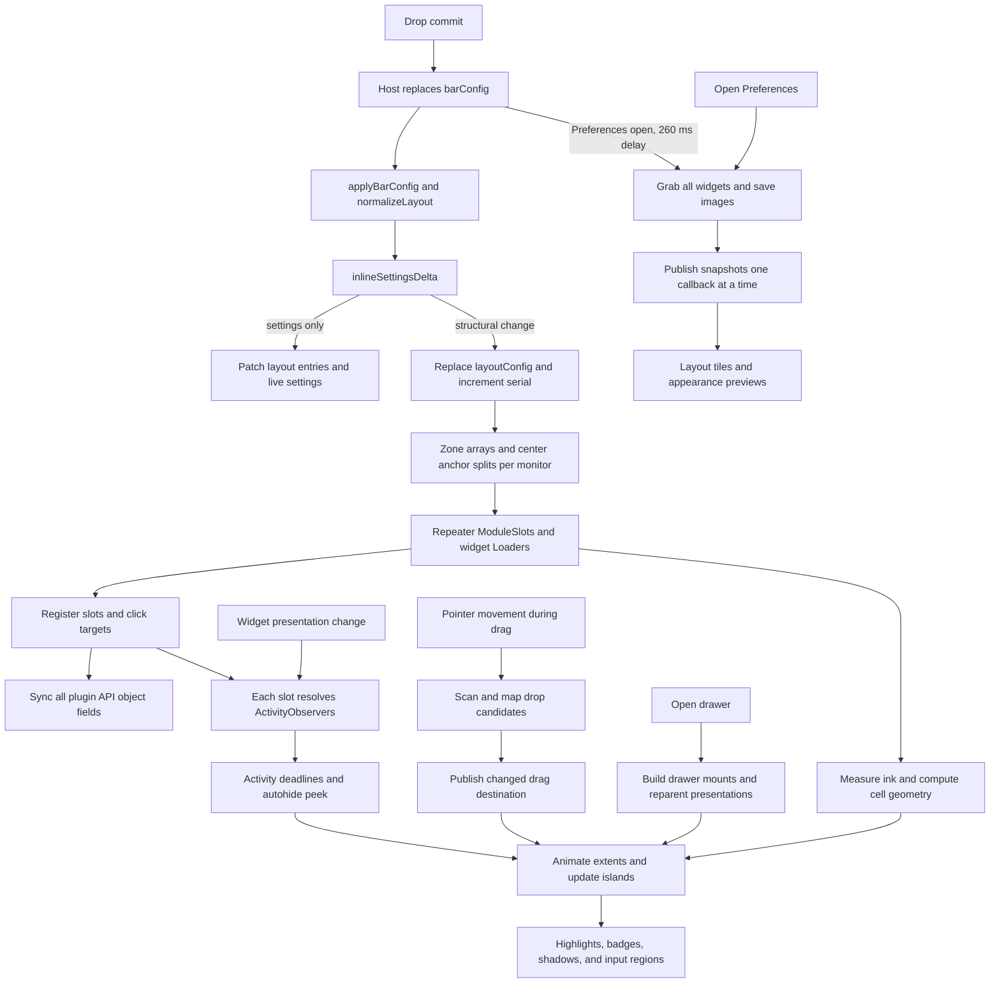

# Powerbar rendering performance audit and implementation plan

Audit date: 30 September 2026. Target: the current working tree, including the
uncommitted spacing, cell, highlight, drawer, and drag changes, based on commit
`04d6681fb10d67111a261e9ee7858648d44f6790`.

Objective: remove avoidable construction, binding evaluation, layout, image
capture, process, and GPU work while preserving the current appearance,
interaction rules, animation curves and durations, preview quality, and update
freshness. The original audit proposed these changes. Implementation and current regression
evidence are recorded in [the implementation report](rendering-performance-implementation.md).

## Findings and priority

The largest structural opportunity is to separate widget lifetime from its
position in a zone. The most direct smaller improvements are to split plugin
API synchronization, stop Preferences' continuous focus tracking at rest, and
avoid loading both indicator orientations. Snapshot capture is another likely
large cost, but its GPU and disk timings need measurement.

| Priority | Finding | Evidence | Proposed change |
| --- | --- | --- | --- |
| P1 | Changed JS array models recreate their delegates | Qt probe: reversing 24 entries destroys and creates 24 delegates | Retain widgets by monitor and instance key; update layout models incrementally |
| P1 | Unrelated API events republish layout snapshots | Current API functions in Qt probe: unchanged sync produces 12 layout notifications for 12 APIs | Separate layout, targets, and popout updates; publish each only when changed |
| P1 | Every target registration makes every slot search the global target list | Current target functions in Qt probe: one registration causes 24 target scans | Maintain target ownership and per-slot lists |
| P1 | Both indicator orientations load, with further active/inactive duplication | Source: two live orientation trees, each with inactive and active loaders | One orientation presentation; one state producer per indicator |
| P1 | Preferences focus tracking runs every frame while the ring is shown | `Preferences.qml:238` | Observe geometry, scroll, focus, and movement; stop frame callbacks at rest |
| P1 | Any config change captures all widgets while Preferences is open | `Preferences.qml:134`, `Bar.qml:104` | Classify capture invalidation; refresh affected captures; bound in-flight work |
| P2 | Global registries, groups, and activity maps broaden dependencies | `Bar.qml:31–52`, `167–225`, `698`, `3265` | Retain records and use local revisions/indexes |
| P2 | Ink measurement and placement can repeat through geometry changes | `HighlightModel.js:64`, `Bar.qml:3329`, `3507–3664` | Explicit ink hints, localized invalidation, one placement flush per dirty item |
| P2 | Tray repeatedly classifies items and has unconditional row layers | `widgets/Tray.qml:23–25`, `167`, `292`, `375` | Classify once, reconcile stable item models, measure layer removal |
| P2 | Preferences rebuilds drag preview arrays and hidden pages remain live | `LayoutEditor.qml:64`, `GroupsPreferences.qml:515`, `Preferences.qml:355` | Stable preview delegates and demand-driven page work |
| P3 | Repeated popup discovery, tooltip polling, and redundant injections | `Bar.qml:1158`, `2034`, `3460–3489`, `3742` | Cache safe discovery, replace proven redundant work, preserve lifecycle guards |
| P3 | Transparent surface area, effects, and clips may limit GPU throughput | `Bar.qml:2121`, `EffectSurface.qml`, `AnimatedSlot.qml:24` | Profile scene graph/compositor costs before changing rendering primitives |

Priorities describe implementation order and likely reach, not measured speedup.
No percentage or absolute frame-time improvement is established by this audit.

## What was actually verified

Run the retained diagnostic with:

```sh
node docs/rendering-performance-probe.cjs
```

The current runner extracts optimized functions from `Bar.qml` and runs isolated
QtQuick fixtures offscreen. The table below records the **original audit baseline**,
before implementation; current results are in the implementation report. It launches
no Omarchy shell, helper daemon, widget command, or desktop interaction. The
fixture has 24 slots and 12 mock API objects, not the user's live layout.

Observed with Qt 6.11.2 on arm64, software rendering:

| Operation | Observed work |
| --- | --- |
| Replace a 24-entry model with deeply identical data | 0 delegate creations, 0 destructions, 0 model-data changes |
| Reverse that array without changing its length | 24 delegate creations and 24 destructions |
| Add one entry to the 24-entry array | 25 delegate creations and 24 destructions |
| Register one target belonging to one of 24 slots | 24 target-list evaluations; 2 observers created and 1 destroyed in the affected slot |
| Repeat API sync with an unchanged layout and 12 APIs | 12 new layout-property notifications |

This refines the comments that say every layout assignment rebuilds every slot.
Identical arrays are optimized away here. Changed models reset their delegates;
an unchanged zone may survive a structural update elsewhere. The common config
object and serial still cause broad evaluation. Likewise, global target changes
make all slots evaluate, but do **not** recreate all observers in this probe.
Binding evaluation, delegate reconstruction, layout work, and painting are
separate costs; a new JS object does not prove a whole window was repainted.

The diagnostic now checks the optimized update functions with fictional slot,
window, API and capture objects. Its array fixture establishes
Qt model behavior; it does not measure full Powerbar construction or GPU cost.

Also run during the audit:

```sh
node --test tests/*.test.cjs
QT_QPA_PLATFORM=offscreen QT_QPA_PLATFORMTHEME= \
QT_QUICK_CONTROLS_STYLE=Basic QT_QUICK_BACKEND=software \
/usr/lib/qt6/bin/qmltestrunner -input tests/qml -o -,txt
```

All eight model test files passed; QML reported 29 passed, zero failed. These
establish the existing portable baseline. No live GPU/compositor profiling,
visual acceptance, or multi-monitor performance measurement was performed.

## Current rendering and update paths



### Configuration and widget lifetime

`Bar.qml:1350–1384` has a useful settings-only shortcut. It avoids structural
assignment for unique registered widget IDs. `BarModel.inlineSettingsDelta`
returns `null` for moves, visibility/identity changes, changed custom modules,
and changed duplicate IDs. Consequently these edits enter the reset path.
Each changed zone or center split can rebuild on every monitor carrying it.
Changing orientation also replaces the bar, center, and list Loader components.
Changing the center anchor can unload lists and construct different ones.

The rebuild includes widget loaders, click registration, observers, per-slot
startup timers, initial property injection, and any widget-owned process or
polling startup. Drag release postpones a commit until the ghost lands partly
to hide this synchronous work (`Bar.qml:997–1124`). The reset also extends the
six-second activity quiet period and resets width-hold state.

`applySettingsDelta` mutates entries inside the existing plain JS structure and
assigns live `item.settings`, but does not replace `slot.entry`. Any incremental
replacement must explicitly update Powerbar-owned entry properties too; relying
on deep JS mutation notifications risks stale badge/visibility/settings policy.
Its current matching uses region and module ID, hence the deliberate duplicate
fallback. Stable instance keys already exist and should be used throughout.

### API, registration, groups, and activity

`syncPluginBarApiObjects` always assigns popout state, creates a filtered target
array, and deep-copies layout. It is invoked for **all** APIs on changes to any
of `activePopout`, `clickTargets`, or `layoutConfig` (`Bar.qml:497–674`). Target
filtering repeatedly searches the ownership array. During construction, every
registration republishes the global list, magnifying setup/reset costs.

`moduleSlots` has a similar publish-per-registration pattern. Group member
lookup filters all monitor slots and repeatedly calls `indexOf` during sorting;
managed lookup ranks entries inside a comparator. Each slot's target search
walks the parents of all registered targets. Group badges aggregate live member
samples, and each slot samples candidate badge properties even when it is not
in a group using badges.

Each activity event copies the complete deadline map. Every slot subscribes to
that shared map, although unchanged scalar deadlines suppress downstream timer
updates. `ActivityObserver.snapshot` reads and serializes presentation fields
even when `enabledForActivity` is false. Some shown widgets are observed because
autohide is enabled even when activity peeking is disabled or the widget is
excluded. Managed reveal policy still needs observation in those cases.

### Geometry, highlights, drag, and drawers

Ink measurement prefers hints, then recursively inspects visible children up to
depth four. Child position/visibility/opacity/size can become binding dependencies.
Cells feed held widths, animated extents, positioners, island sizes, highlights,
compound thumbs, badges, drawer sizes, and input regions. ActiveWindow animates
its own width while its slot also animates, so changes can drive a cascade;
removing either animation would need equivalent motion, not merely equivalent
final geometry.

The latest code already uses per-zone highlight layers that move with the
islands. Bar highlights no longer run a `FrameAnimation`. They use separate
geometry signal handlers calling `place()`. Multiple signals from one layout
change can repeat coordinate mapping. Equal-gaps overlap detection searches
`moduleSlots` for each shown highlight, including other monitors before filtering.
Compound target centers and pitches are calculated even before a thumb is shown.

Drag capture is once at pickup. `updateIconDrag` already suppresses publishing
an equivalent drop descriptor, which is valuable. It still constructs and maps
candidates by scanning all slots per pointer event, followed by a separate
scan for a group target. Settle mapping runs for the bounded animation interval.
Ghost panels exist on all screens; their image/settle bindings can still evaluate
while their windows are invisible unless explicitly gated to the active screen.

Drawer membership is empty at rest and widget presentations are reused through
reparenting. These are useful existing optimizations. A changed drawer slots
array can recreate its mount delegates, temporarily changing `drawerHost` and
layout. Named-menu width repeatedly measures all member titles when relevant
ink or membership changes. Placement correctly reads explicit source/island
geometry; optimizations must preserve tracking through animation and scrolling.

### Preferences and previews

All four pages are constructed inside `StackLayout` and keep their bindings
while invisible or while the Preferences window is closed. Layout records,
group lists, preview models, cached image sources, and wallpaper sources can
still change. Hidden QML items keep bindings and processes active; visibility
alone only suppresses drawing. [Qt performance guidance](https://doc.qt.io/qt-6/qtquick-performance.html).

The focus ring traverses parents and maps two items every frame while shown,
including with animations disabled. Scroll handling in `PrefsForm.closePopups`
recursively visits all controls on every content-Y change. Dragging in Layout
builds fresh cell arrays; dragging in Groups builds fresh row arrays. Changed
arrays reset those preview delegates, causing layout and image setup work.

Opening Preferences clears snapshots, lists cache files, changes every image's
versioned URL, and captures all loaded widgets on the target screen. Any config
change schedules another full capture. Each capture uses twice the logical
width and height and saves non-group images to disk. Each callback copies and
republishes the complete snapshots object. There is no capture generation guard
for closing/reopening, screen changes, or overlapping batches.

`grabToImage` performs offscreen rendering and GPU-to-CPU copying. Its cost is
more than a property update. [Qt Item documentation](https://doc.qt.io/qt-6/qml-qtquick-item.html#grabToImage-method).

`BarBackdrop` uses an uncached wallpaper image decoded at `Style.space(1600)`.
Layout creates three backdrop instances even though only the shown row draws
one; the style picker has three more, and Appearance has another. Identical
sources with `cache: false` give a concrete opportunity to share decoding.
`WidgetIcon` similarly disables disk image caching and retains two Image items
per thumbnail, while URLs already contain an invalidation version.

### Built-in widgets and effects

Indicators is the largest built-in lifetime issue. Both orientation trees are
instantiated; `reportActiveState` suppresses reporting but does not unload or
stop the hidden orientation. Each also has one instance for every configured
inactive indicator and another for each active indicator. For N configured and
A active indicators, the source constructs approximately **2 × (N + A)**
indicator objects per widget instance, excluding loader wrappers. Dictation
starts a streaming process in each copy; Reminder queries at construction and
on refresh; ScreenRecording queries when its bar arrives and on refresh.
Existing services supply Dnd, NightLight, and StayAwake. The active indicator
ListModel already uses insert/remove/move, an approach worth extending.

Tray calls `bucket` separately for pinned, drawer, and all items. Each filters
status, classifies the item, and may search layout entries for ownership.
Changed JS item arrays reset row delegates. Its drawer Row/Column has an
unconditional layer, while symbolic icons legitimately use a texture and tint
effect. Management and menu delegates are built with Repeaters rather than
views that create only visible rows. Retain submenu opener ownership and the
250 ms click guard: they address real menu lifetime and interaction problems.

Workspaces calculates sorted IDs separately for columns and the Repeater;
workspace object lookup scans the whole workspace list for each button. A
workspace membership change that produces the same numeric IDs is optimized
by Qt in the probe's identical-array case, so measure before calling this a
reconstruction bottleneck. ActiveWindow, Microphone, and Spacer otherwise use
straightforward reactive bindings. SystemUpdate's six-hour refresh and
KeyboardLayout's conditional ten-second recovery poll are data policy, not
animation loops. Custom command widgets have user-configured polling; retain
its cadence and duplicate-instance semantics.

The bar's stable layer surface avoids remapping for normal drawer/autohide
transitions. Surface padding, locally drawn shadows, transparent buffers, input
regions, and clip nodes still contribute render/compositor costs. Item layers
use extra textures and affect batching; clipping is not automatically a speed
optimization. [Qt Item layer guidance](https://doc.qt.io/qt-6/qml-qtquick-item.html#memory-and-performance),
[Qt rendering guidance](https://doc.qt.io/qt-6/qtquick-performance.html#clipping).

The installed host's `WidgetButton.qml` also contains an unconditional opacity
animation and a color animation controlled by `foregroundAnimationEnabled`.
Powerbar's global animation setting does not cover every imported widget
animation today. Track this as a host boundary; changing shared host code or
third-party animations is outside this repository's optimization patch.

## Proposed architecture and limits on update work

Keep a persistent widget owner for each `(monitor, powerbarInstance)` and a
persistent group owner for `(monitor, groupId)`. Placement mounts own layout
geometry and input routing. They refer to those owners and display the existing
presentation item. Widget owners live outside orientation and zone Loaders so
changing a mount cannot destroy widget state. The original item's QsWindow and
facade remain attached to the same monitor.

Use explicit delta routing for layout order, membership, entry settings,
visibility, group presentation, bar geometry, appearance, registry components,
and preview invalidation. Compare supported nested settings completely; a
fingerprint can accelerate comparison, but avoid unsafe partial field lists.
Retain object identity when a value did not change. Host config remains the
source of truth and continues to persist through existing APIs.

| Trigger | Intended work after optimization |
| --- | --- |
| Reload identical config | No construction, layout publication, capture, or API publication |
| Change one widget's settings | Update that instance on each monitor; remeasure only if its presentation changes |
| Change a bar color, shadow, border, or opacity | Update affected surfaces and colors; preserve widget objects |
| Change size, spacing, or spacing mode | Necessary geometry update for affected cells; preserve widget objects |
| Move/reorder a widget or change group membership | Reconcile affected layout mounts per monitor; preserve existing widget objects |
| Switch a widget between shown and managed | Update policy/mount and existing timers; preserve widget object |
| Set explicit hidden / restore | Retain current policy: hidden widgets unload; only that widget reloads on restore |
| Change center anchor or bar orientation | Change layout/mount topology; preserve widget objects where the host contract permits |
| Register/unregister a click target | Update the owning slot and plugin API target list; no layout publication |
| One managed widget event | Update its deadline and relevant group header/monitor presentations; no unrelated observers restart |
| Pointer moves within the same drop destination | Ghost coordinates and required hit testing; no destination-model publication |
| Open/close a drawer | Mount/reparent its presentations and run existing motion; no widget or service restart |
| Open Preferences | Show the selected page, refresh current captures/cache metadata, preserve existing navigation state |
| Theme/font/wallpaper change | Invalidate the relevant pixels/metrics/cache; preserve unrelated widget/service identity |
| Registry hot reload | Replace only widget objects using the changed component |
| Monitor removed | Dispose that monitor's owners/mounts and clear references to its surfaces |

## Implementation sequence

### 0. Establish live baselines and behavioral references

**Deliverable:** a fixture-driven performance runner and trace report before
optimization. Extend the existing probes into actual host-path counters, with
instrumentation off by default. Use fictional widget data, including duplicate
IDs, text widgets, grouped members, compound targets, and dynamic tray entries.

Measure separately: widget/delegate construction and destruction; target/API
publications; observer baselines and activity events; ink and placement calls;
image requests/completions/PNG saves/bytes; helper process starts; JS/binding and
layout time; render/sync time; frame intervals; CPU and resident/texture memory.
Use QML Profiler for bindings, handlers, construction, and scene graph work,
then compositor/GPU measurements for effects. Profile an isolated supported
host fixture or the existing shell with a supported profiler connection; do not
start an additional shell. Record Qt/Quickshell versions, renderer, scale,
monitor refresh rate, and whether the run includes profiler overhead.
[Qt profiler documentation](https://doc.qt.io/qtcreator/creator-qml-performance-monitor.html).

Scenarios: 30 s idle; sustained hover; one value update; 100 settings updates;
100 within-zone and cross-zone moves; 100 drawer open/close cycles; sustained
main-bar/drawer/Preferences drags; tray expand and submenu navigation; reopening
and switching Preferences pages; group activity bursts; theme/font change;
registry reload; monitor removal. Run 1 and 3 monitors with 10/30/100 widgets,
using the small case for ordinary acceptance and the others for scaling.

Capture representative geometry and visual states before changes: all edges,
styles, sizes, and spacing modes; animations on/off; each group member display;
keyboard focus, overlap fade, badges, drag gaps/ghost/settle, and HiDPI. Compare
the optimized version against the current behavior and the spacing spec where
that behavior already matches. Existing spacing-spec gaps are separate work.

**Gate:** a repeatable workload with counters and p50/p95/p99 timings. Do not
rank measured bottlenecks using whole-shell CPU alone, and do not treat
software/offscreen results as proof of desktop smoothness.

### 1. Split API synchronization and scope target ownership

**Files:** `Bar.qml` API functions, registration functions, target lookup.

Split synchronization into layout, click-target, and popout operations. A
popout change must not serialize layout; a target change must not publish
layout. Cache normalized layout serialization by revision and parse a separate
copy for each facade only when it needs updating. Preserve per-plugin mutable
copy isolation, object ownership checks, and foreign-popout markers.

Maintain per-plugin and per-slot target collections and per-window slot
indexes. Resolve a target's owner once on registration or genuine reparenting;
refresh the mapping on destruction and drawer moves. If registration occurs
before the presentation has a known owner, queue one resolution pass and use a
correct fallback until it completes. Publish only changed local lists. Batch
bulk construction/removal notifications, while synchronous activation always
sees current targets. Make unregistering an absent target a no-op.

**Gate:** one target change touches one slot's observer membership and its
plugin API target list. Popout changes publish zero layouts. Duplicate plugin
instances, multiple monitors, drawer reparenting, placeholder clicks, and
plugin disablement retain their current routing and ownership boundaries.

### 2. Make idle chrome event driven

**Files:** `Preferences.qml` focus ring, `PrefsForm.qml`, bar placement handlers.

Resolve the focus ring's viewport and relevant ancestor chain when its target
changes. Subscribe to target/ancestor geometry, parent/transform changes, and
viewport scroll/size. Refresh once after layout settles. Keep bounded frame
tracking only while a movement cannot be followed correctly through those
signals; stop after motion or scrolling ends. Animations off must still update
correctly during scrolling and geometry changes. Preserve the ring's glide
curve, clipping, and focus behavior.

Coalesce bar highlight/thumb/badge placement per dirty item at the scene's
layout/update boundary. Repeated x/y/width/height signals should produce one
placement flush, with no added visible frame lag. Recompute on host-layer,
orientation, radius, and cell-token changes too. Replace per-scroll recursive
popup discovery with tracking open controls, or discover once per opening.

**Gate:** zero Powerbar frame callbacks for stationary chrome, including an
open Preferences page with a visible ring. Scrolling, resize, theme change,
focus switching, and moving islands keep geometry accurate frame by frame.

### 3. Remove duplicate indicator producers

**Files:** `widgets/Indicators.qml`, `indicators/*.qml`; potentially a new
Powerbar-local state component after checking the host service contract.

First instantiate only the current orientation's presentation. Preserve the
existing active indicator ListModel, newcomers-at-the-far-side ordering,
inactive reveal opacity, hover hold, tooltip, click, and wheel behavior.

Then separate indicator state from active/inactive presentation. Share
Dictation's stream and Reminder/ScreenRecording queries between both
presentations. Prefer existing allowed host services; otherwise use a
Powerbar-owned state object, with one producer per distinct settings contract.
No process creation should depend on an indicator becoming active or changing
orientation. Where compatible, share the same producer across monitors.
Compare active state/order before publishing to avoid equal-state churn.

**Gate:** one orientation tree and one state producer per distinct indicator
configuration. Events remain live while inactive, managed, or grouped; refresh
IPC reaches all presentations once. Switching orientation, rapid activity,
multiple monitors, stream failure, and removal produce no stale state or
orphaned process. Preserve the meaning of `activeOverride` during migration.

### 4. Retain widget owners and reconcile layout models

**Files:** `Bar.qml` configuration path, `ModuleSlot`, `ModuleList`,
`CenterModules`; `BarModel.js`; add a focused reconciliation component/model.

Prototype lifecycle retention before replacing the existing layout path. Use a
stable owner collection independent of zone order. An incrementally maintained
`ListModel` for each placement list can manage cheap mounts with
insert/remove/move/setProperty. **Using ListModel alone does not preserve a
widget moved between separate models or orientation Loader trees.** Retained
owners must sit outside those trees. Keep widget state and Powerbar policy in
the owner; layout mounts hold animated geometry and refer to the owner.

Reconcile normalized records by stable instance key. Update entry/settings on
all monitor copies of that exact key, including duplicate IDs and custom
modules. Reuse unchanged owners and mounts; instantiate only additions or
changed registry components. Unload explicit hidden widgets as today. Preserve
custom polling and third-party initialization contracts. Reconcile group
headers/membership without restarting members. Keep drawer dismissal rules on
explicit edits and hot reload; avoid incidental closures from unrelated work.

Replace broad `barConfigSerial` with relevant revisions. Arm initial activity
baselines only for newly constructed widgets. Preserve the current quiet-period
timing for the same user operations; narrowing suppression is acceptable only
when equivalent observable activity behavior is demonstrated. Test events
during and immediately after edits, startup, and reload. Keep drag commit timing,
preview, settle, and correction motion until the equivalent retained path is
verified; reduced commit work should remove freezes without shortening motion.

**Gate:** moves, shown/managed changes, anchor changes, group edits, and ordinary
settings/appearance edits create and destroy zero existing widget objects.
Only hidden/add/remove/component-reload/monitor changes affect the relevant
widget lifetimes. Test duplicate identities, stale asynchronous callbacks,
popouts, width holds, all drag routes, all edges, and monitor removal through
the real call paths. Retain a diagnostic reset fallback for unsupported widget
component replacement, not for every structural edit.

### 5. Localize groups, activity, and geometry

**Files:** `Bar.qml` lookup/activity/geometry functions, `ActivityObserver.qml`,
`HighlightModel.js`, `CellModel.js`, `ManagedDrawer.qml`, group models.

Maintain indexes for entry-by-key, group-by-ID, owner-by-key, member order,
per-window slots, managed slots by zone, and group headers. Build/update these
once per relevant delta. Publish only affected memberships; group label changes
must not republish member lists. Use retained per-instance activity deadline
properties so one event avoids copying the full map. Preserve shared activity
between monitor copies and repeated explicit `powerbarActivity()` signals.

Gate snapshot evaluation when observation is unnecessary, then establish a
fresh baseline on enablement. Derive eligibility from managed/group reveal and
actual peek policy, including global/per-widget exclusions. Observe baseline
changes without creating false activity. Sample badges only for members whose
group uses badges; aggregate only changed groups. Do not suppress legitimate
repeated events just because their presentation values are equal.

For ink, use existing kit hints and optional explicit first-party hints before
recursive fallback. Keep the fallback for arbitrary third-party widgets. Cache
by actual item/children/metric/visibility changes and orientation, not just
instance key or text. Geometry/opacity animations can change fallback ink, so
any dependency removed needs a replacement invalidation signal. Reuse one
computed cell rectangle for highlight, badge, and thumb placement. Limit overlap
checks to active highlights in the same layer; retain paint order and 45% fade.
Cache member title metrics by title/font/theme and update only changed widths.

**Gate:** a single widget event updates only its owner, relevant group, and
necessary neighbor geometry. No unrelated observer resets. Width growth,
eight-second shrink hold, cell centering, menu sizing, compound thumbs, badges,
and Equal-gaps overlaps match existing accepted geometry and motion.

### 6. Bound and narrow preview capture; reuse image decoding

**Files:** `Preferences.qml`, `Bar.qml:captureWidgetImages`, `WidgetIcon.qml`,
`BarBackdrop.qml`, preview consumers.

Introduce a capture request with opening generation, target screen, widget
identity/revision, and pending count. Reject stale callbacks after close,
reopen, monitor change, owner replacement, or a newer request. Check the return
value of `grabToImage` so failed requests cannot block a queue. Keep current
resolution, capture source, horizontal-only policy, and disk fallback behavior.

Use invalidation based on what is captured. Layout moves may change the
on-bar/off-bar capture source; size/theme/font changes affect many captures;
spacing may affect offsets/clipping; background-only surface changes generally
need preview chrome updates rather than widget capture. Unknown third-party
presentation changes require a conservative fallback. Refresh all relevant
widgets on opening for current freshness, then target changes during the
session. Do not replace this with a periodic polling timer or reduce fidelity.

Use a small measured in-flight limit and prioritize thumbnails needed by the
current page. Keep existing images until replacements arrive. Publish completed
images in small bounded batches instead of copying the map once per result;
don't hold fast thumbnails until a slow/failed capture completes. Separate disk
persistence from immediate preview delivery. Persist the latest accepted image
needed by a hidden widget, and measure saves before adding a worker or queue.

Allow Qt's image cache to share wallpaper and thumbnail decoding. Use explicit
content versions on actual wallpaper/image replacement, preserving refresh on
open when no reliable watcher exists. Remove image work from hidden pages and
non-shown layout-row backdrops. Choose decode sizes from the largest required
preview and DPR only after visual comparison establishes equal quality.

**Gate:** zero captures after identical reloads or irrelevant changes; changed
captures produce bounded notifications and no stale result overwrites. Closing
Preferences drains/cancels publication safely. Reopening, vertical bars,
unknown/hidden widgets, wallpaper/theme changes, and HiDPI retain current images
and fallback behavior. Compare opening latency and preview completion latency,
not just total capture time.

### 7. Reconcile tray and Preferences presentations

**Files:** `widgets/Tray.qml`, `widgets/TrayModel.js`, `widgets/Workspaces.qml`,
`LayoutEditor.qml`, `GroupsPreferences.qml`, `Preferences.qml`.

Classify tray items in one pass; compute layout ownership once per layout
revision. Maintain item models by actual tray object identity, keeping ID-based
saved pin/hide semantics. Incrementally update affected delegates on status,
pin/hide, title, icon, add/remove, and menu changes. Preserve tray icon sources,
DPR, tint, click behavior, expansion geometry, and the 600 ms reveal curve.
Use demand-driven management/menu delegates; virtualize long menus/lists only
if traces justify it, preserving scroll, focus, submenu lifetime, and click guard.

Use stable Layout/Groups preview delegates and a separate insertion-gap mount
rather than embedding placeholder records in newly allocated arrays every time
the destination moves. Guard unchanged insertion cells/positions. Preserve
wrapped-row hit testing, keyboard lifting, filtering, cancel, and selection.
Build the nine cell membership lists once per layout delta. Cache workspace IDs
and object lookups by workspace membership; preserve reactive occupied/focused
buttons and do not tie the model to focus changes.

Lazily construct Preferences pages as measured opening budgets allow; retain
visited page state (selection, filter, cursor, scroll) for current session
semantics. Disable expensive preview/model work on inactive pages, mark it
dirty, and refresh before it is shown. Support direct `showGroup`, digit
shortcuts, focus chain, and delayed construction without a visible blank page.

**Gate:** drag within the same insertion position reconstructs zero preview
delegates. Changed tray membership replaces only affected items. Page switches,
first opening, scrolling, filters, keyboard focus, and reopening match current
behavior. Virtualization must not reintroduce target-registration churn.

### 8. Profile GPU and remaining lifecycle overhead

**Files:** `EffectSurface.qml`, `AnimatedSlot.qml`, tray layers, `Bar.qml`
surfaces, tooltip and popup helpers.

Measure tray expansion with and without its outer row layer, keeping the
symbolic-icon source texture/effect intact. Remove a layer only after matching
pixels, clipping, stacking, and expansion motion. Evaluate clip-node cost
without removing required text caps, drag clipping, or drawer viewport clips.
Keep shadows, blur, opacity, corner rounding, and surface namespace behavior.

Measure transparent surface area at common resolutions and DPR. Keep stable
surface dimensions during interaction; resizing or remapping on each drawer
transition would undo an existing optimization. Consider tighter fixed padding
only if maximum shadow/menu geometry remains fully contained and compositor
cost is measurable. Avoid caching animated surfaces in textures by default.

Cache popup discovery by live owner/component generation, with invalidation
for dynamically added panels and anchors. Move `requestPopout`'s same-owner
check before traversal only after proving repeated requests do not need to
rediscover a newly created panel. Replace tooltip's 100 ms hover check with
reliable lifecycle/hover signals only when every supported target is covered.
Measure redundant `injectProps` calls; retain deferred injection where host
construction ordering requires it. Asynchronous Loader incubation is optional
for true additions, with the same completed first presentation; it cannot
replace eliminating unnecessary construction.

**Gate:** measurable reduction in render/sync/compositor or startup cost with
identical accepted visuals and input regions. Reject changes that merely shift
work to later frames or increase memory without an observed responsiveness gain.

## Acceptance and completion

For each implementation step, first add a regression or counter check through
the affected actual call path. Existing arithmetic/model tests alone cannot
prove widget retention, scoped observer updates, captures, or desktop frame time.
Run the relevant portable model/QML checks and plugin validation, then the
specific host scenarios from step 0. Keep each architectural change reviewable
and independently revertible.

Use these operational targets:

- Zero unnecessary existing-widget construction/destruction for normal edits,
  moves, reveals, and drawer transitions.
- Zero stationary Powerbar chrome frame callbacks; scheduled widget updates,
  recovery polls, and deadlines retain their current cadence.
- Zero layout publication on target/popout changes, and no unrelated
  per-instance activity/observer reset.
- No work scaling with all monitors for a monitor-local hover or drag.
  Persisted config edits necessarily reconcile the corresponding layouts on
  every monitor, while shared data producers should avoid duplicate queries.
- Zero redundant preview captures for proven unchanged pixels; bounded capture
  concurrency/publication and versioned cache reuse.
- Stable idle memory and producer/observer counts after 100 interaction cycles;
  account for legitimate image and glyph caches when assessing growth.
- Lower p95/p99 GUI-thread work and fewer missed frames on the measured slow
  paths. Use the monitor's budget (`1000 / refreshRate` ms; 16.67 at 60 Hz,
  8.33 at 120 Hz), and aim for at most 25% of that budget in Powerbar's own
  synchronous GUI work during interaction. This is a profiling target, not a
  promise about unrelated shell plugins or compositor load.
- Unchanged screenshots/geometry and interaction outcomes; unchanged motion
  durations/easing, placeholder activation, activity intervals, drawer grace,
  autohide hold, keyboard routing, tray menus, and third-party service access.

Land in this order: **baseline → API/targets → idle chrome → indicators →
retained widget owners → localized state/geometry → previews → tray/editor
models → measured GPU refinements**. Re-rank later steps using live traces.

The pure helpers in `AppearanceModel.js`, `CellModel.js`, `DragModel.js`,
`ManagedModel.js`, `GroupBadgeModel.js`, `GroupsModel.js`,
`PreferencesModel.js`, and `KeyboardLayoutModel.js` were included in the audit.
The remaining small controls (`PrefsChoice`, `PrefsSlider`, `PrefsToggle`,
`PrefsSection`, `KeyCap`, `IconGrid`) have no independent continuous render loop.
Their main cost comes from parent invalidation, construction, and inherited host
controls; changing their visual primitives has no established benefit.

Preserve the useful optimizations already present: settings-only application,
equivalent-drop suppression, once-per-drag capture, widget presentation reuse
in drawers, inactive center-list unloading, signal-driven activity, bounded
motion, and stable mapped bar surfaces. Optimize their remaining invalidation
and ownership boundaries before replacing them.
